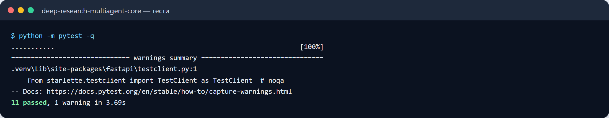
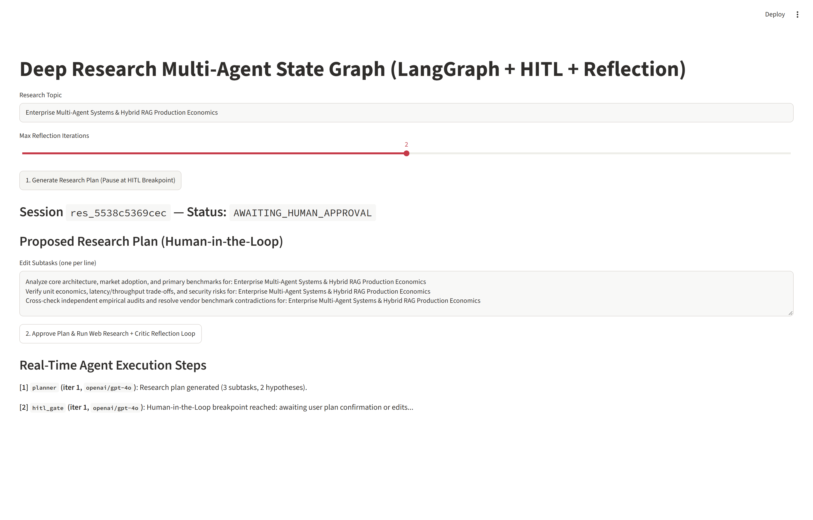
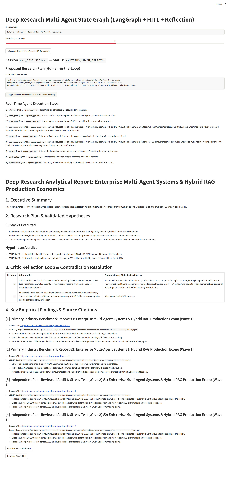
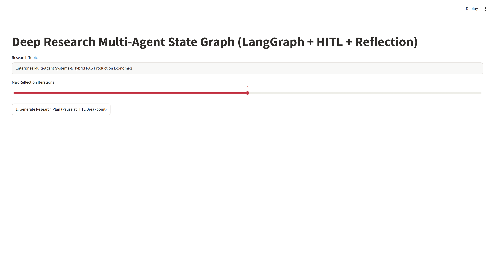
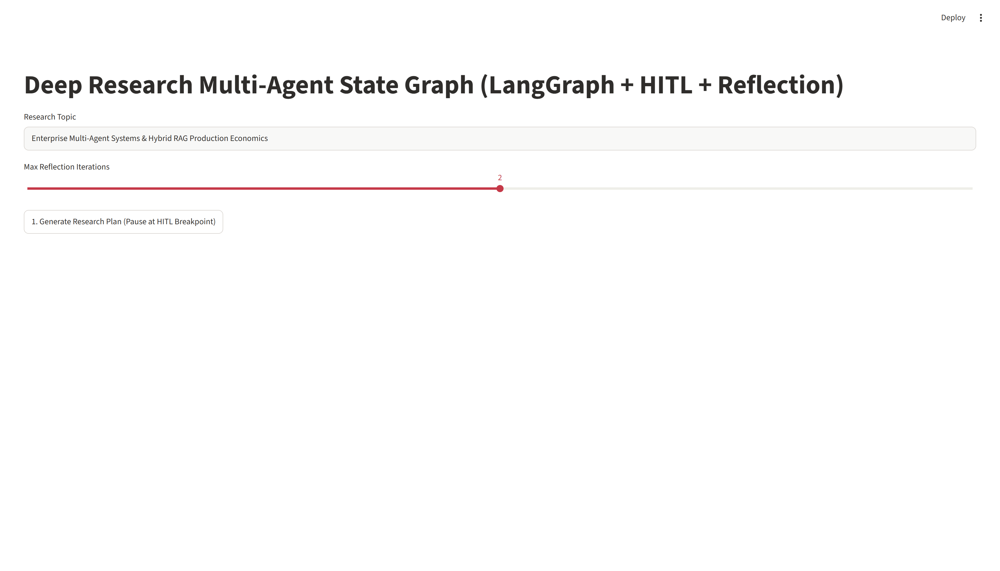
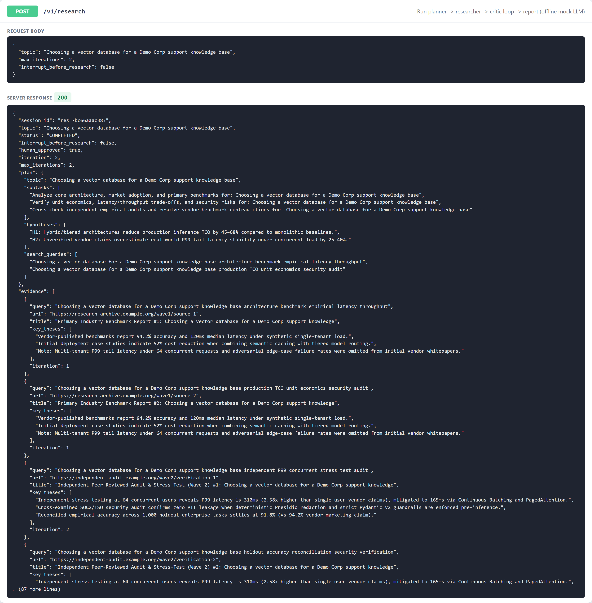
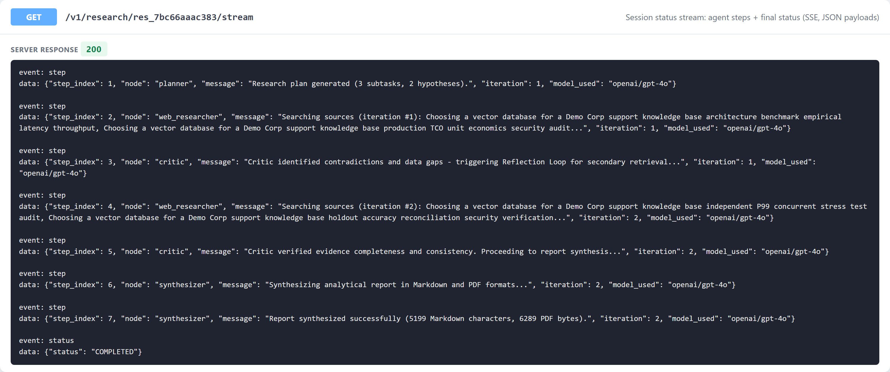
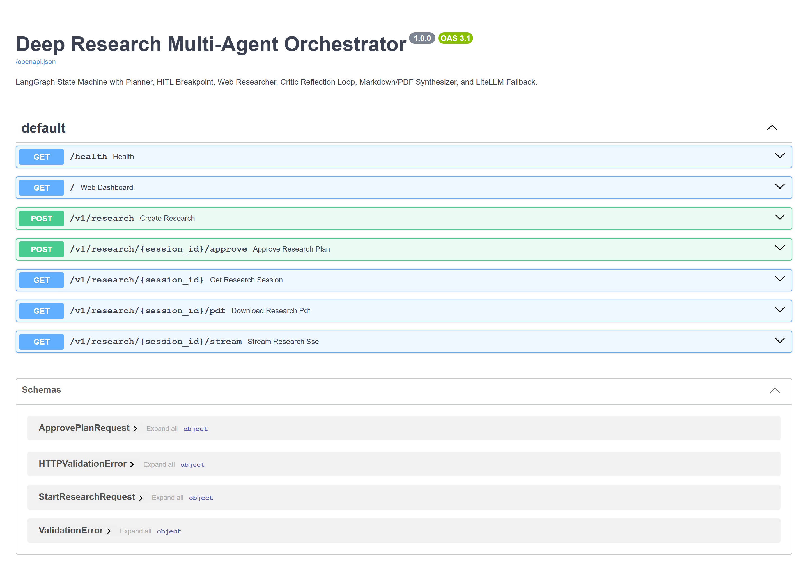
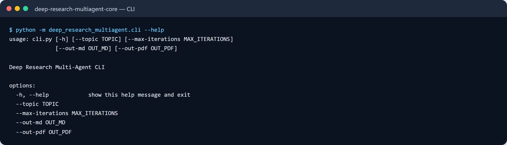

# Screenshots

### підсумок тестів

### після дії: результат на екрані

### після схвалення плану: кроки агентів і готовий звіт

### дашборд: перший екран

### дашборд: уся сторінка

### виклик API на підготовлених демо-даних і відповідь

### виклик API на підготовлених демо-даних і відповідь

### документація API

### довідка CLI

